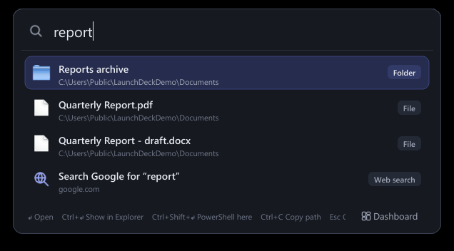
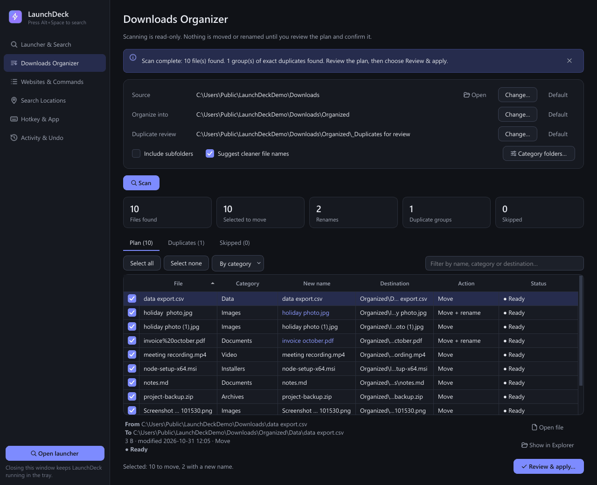

# LaunchDeck

A keyboard-first Windows tray app: an **Alt+Space launcher** for apps, files, websites and commands, plus a
**Downloads organizer** that never changes a file until you review and confirm the plan - and can undo every move.



<sub>Offscreen render of the real launcher window over demo files (a throwaway folder in `C:\Users\Public`).</sub>

## Why

Windows search mixes web results into local ones and is slow to reach files outside the Start menu; the Downloads
folder quietly fills with duplicates and `invoice%20(3).pdf`-style names. Existing launchers solve the first problem,
and "auto-organizers" solve the second by moving files behind your back. LaunchDeck does both locally and
conservatively: deterministic ranking, no cloud or AI, no network access unless you open a website or web search,
and file operations that are previewed, re-validated just before they run, never overwrite, and can be undone.

## Features

**Launcher**
- Global hotkey (Alt+Space by default, configurable; conflicts are reported, never silently changed).
- Finds Start Menu apps, Microsoft Store apps, files and folders in chosen locations, saved websites, custom command
  aliases and built-in actions; a clearly labelled web search is always last.
- Local, deterministic ranking: exact → prefix → word starts → initials (`vsc`) → typo-tolerant (`chrme`), with a
  small capped boost for things you open often.
- Background SQLite index; symlinks and junctions are listed but never followed; system folders are skipped.
- Custom commands always run with an argument list and `shell=False`; typed text can never become shell code.

**Downloads organizer**



<sub>Offscreen render of the real dashboard after a real scan of 10 demo files. Nothing was applied. The global
hotkey was not registered while rendering; the header shows the status text the app reports when registration
succeeds.</sub>

- Read-only scan, classification into category folders, cleaner name suggestions.
- Exact duplicates by size + SHA-256 (files that change while hashing are never treated as duplicates).
- Every move is checked again right before it runs, never overwrites, and is recorded in a history with **Undo**.
- Damaged databases are quarantined and rebuilt instead of crashing the app.

Full usage details (keys, ranking, commands, search locations, organizer safety model, undo, settings,
troubleshooting): [docs/USER_GUIDE.md](docs/USER_GUIDE.md). Architecture notes: [docs/DECISIONS.md](docs/DECISIONS.md).

## Tech stack

Python 3.11+ (developed and tested on 3.14) · PySide6 / Qt 6 (the only runtime dependency) · SQLite (standard
library) · Win32 APIs via `ctypes` (`RegisterHotKey`, known folders, single instance) · PyInstaller for the packaged
build · pytest.

## Requirements

Windows 10 or 11, 64-bit, and Python 3.11+ (64-bit) - or the packaged `LaunchDeck.exe`, which needs nothing installed.

## Install and run

```bat
git clone https://github.com/fadlonerez-sketch/launchdeck.git
cd launchdeck
python -m venv .venv
.venv\Scripts\python -m pip install -r requirements.txt
run.bat
```

`run.bat` checks the Python version and PySide6, then starts LaunchDeck in the tray (a second start just shows the
running instance). Press **Alt+Space**, type, press Enter. Set `LAUNCHDECK_DATA_DIR` to keep a test instance's data
separate from `%LOCALAPPDATA%\LaunchDeck`.

**Packaged build:** `pip install -r requirements-dev.txt`, then `build_exe.bat` → `dist\LaunchDeck\LaunchDeck.exe`
(one-folder build); the script runs the packaged self-test afterwards.

## Tests

```bat
.venv\Scripts\python -m pip install -r requirements-dev.txt
.venv\Scripts\python -m pytest tests ^
  --deselect tests/test_packaged_and_hotkey.py::test_real_hotkey_registration_and_conflict ^
  --deselect tests/test_packaged_and_hotkey.py::test_failed_change_keeps_previous_hotkey
```

Result on the development machine (Windows 11, Python 3.14, PySide6 6.11.2): **149 passed, 1 skipped**
(the symlink test needs Developer Mode; a junction test covers the same traversal rule). Tests run Qt offscreen
against temporary folders and an isolated data directory, and replace shell launches with recorders. The two
deselected tests register real global hotkeys with Windows and are meant for manual runs only - see
[CONTRIBUTING.md](CONTRIBUTING.md).

## Project structure

```
main.py                   entry point (single instance, command line)
launchdeck/app/           application controller, settings, logging, self-test
launchdeck/launcher/      indexer, background index service, ranking, search, URLs, Store apps, actions
launchdeck/commands/      custom command model, validation and shell=False runner
launchdeck/organizer/     categories, naming, scanner (+SHA-256), planner, safety checks, executor + undo
launchdeck/storage/       SQLite stores with migrations and corruption quarantine
launchdeck/winsys/        hotkey, known folders, shell, single instance, Start-with-Windows
launchdeck/ui/            launcher window, dashboard pages, dialogs, theme, icons
tests/                    pytest suite (offscreen Qt, temporary folders)
```

## Known limitations

- Windows only.
- The global hotkey uses `RegisterHotKey`: a combination another program registered first cannot be taken, and keys
  are not delivered while an elevated window has focus.
- Store apps are listed through Windows PowerShell's `Get-StartApps`; if it is unavailable, only that source is
  reported as unreadable.
- Undo restores files only to their original folder and leaves folders created by organizing in place.
- Duplicate detection works within one scan, not against previously organized files.
- The packaged build is unsigned, so SmartScreen may warn on first run.

## License

[MIT](LICENSE). PySide6/Qt, installed as a dependency and bundled in packaged builds, is licensed under the LGPL-3.0.
